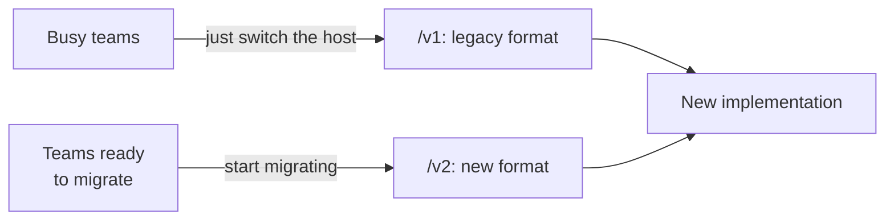

---
date:
  created: 2026-11-22
categories:
  - Leadership
tags:
  - api-design
  - backward-compatibility
  - collaboration
slug: keep-the-contract
---

# Keep the contract :writing_hand:

A coworker of mine had to reimplement a central internal API that many teams depend on,
and they had a better response format in mind. Here's why **keeping the existing
contract**, at least at first, seems to be the way to go.

<!-- more -->

## Situation

We are rewriting an internal API at a company that relies heavily on a distributed
system. The API is a **central component**: it is used by multiple projects and multiple
teams. I won't go into why the reimplementation is needed. For this post, let's just
accept that there are reasons for it.

The task fell to a coworker of mine. First, they needed to analyze the request patterns
of the old API and evaluate its users: who uses it the most, which functionality those
users rely on, and whether the API offers functions that are not used at all. Once they
were done with the analysis, they needed to decide how to implement the new version.

After the analysis, my coworker realized that there would be a more suitable response
format. The current one is a bit quirky, not always logical, and sometimes contains
duplicated information. They suggested a **more concise format**.

## What I tried

This started a debate. My coworker tried to evaluate how much effort the changes would
be for the other teams, to convince me that **supporting the old format was not necessary**.

So I looked into the **priorities of the other teams**. This gave me a way to understand
where we stand, and in some cases it didn't look great from an **availability** point of
view.

If we keep the old format, clients can switch immediately with little integration
effort: they **just switch the host**. With the new format, switching might require
**substantial changes** on their side.

In a perfect world, of course, every team would be able to rewrite their integration
immediately. In reality, many teams have other projects, some of them **time-sensitive
work** they are doing for our customers.

So my feedback to my coworker was to **support the legacy format first**.

## What happened

After my suggestion, my coworker wanted to implement two separate endpoints: one for the
legacy format and one for the new format. I suggested a **versioned API** instead. We first
support the initial format, but a v2 format is already available for the teams who can
start migrating right away. The old format stays for the teams who are busier, and they
switch over when they have the time. This way, we can limit having to maintain two APIs.

The versioned API was very much to my coworker's liking, and to mine as well, because it
lets us tackle the reason we are rewriting the service quite quickly :handshake:

## What I learned

What I learned is that my role as a team lead is to be the **bridge between business and
engineering**. Sometimes an engineer would pick the perfect solution, but as a team lead,
I'm responsible for finding solutions that **serve the customers** while also leaving us
the **option to improve our services in the future**.
